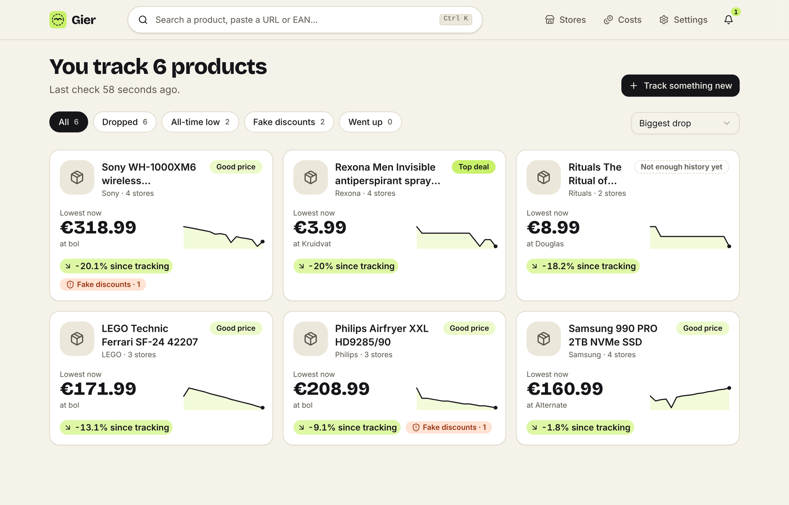
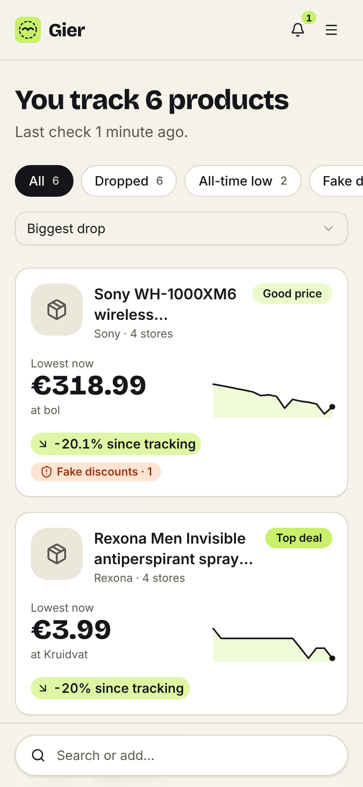
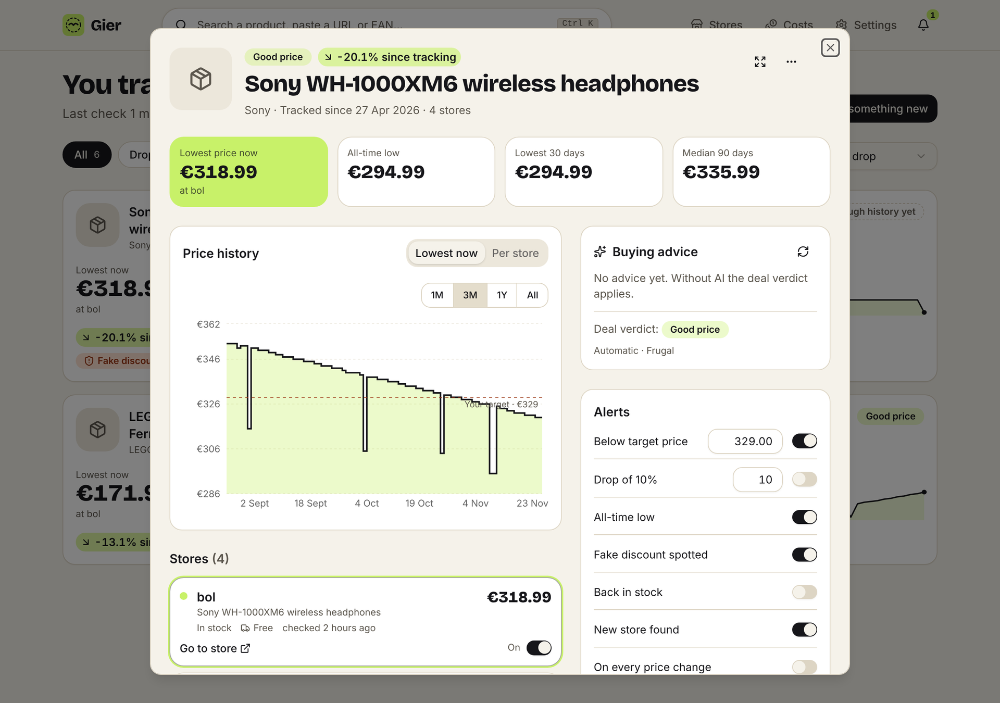
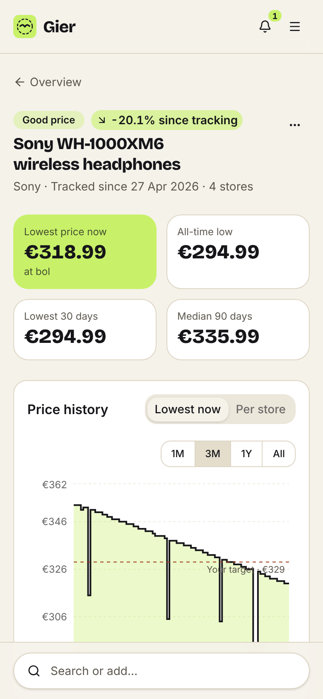

<p align="center">
  
</p>

<h1 align="center">gier</h1>

<p align="center"><strong>Circles over your prices until they drop.</strong></p>

<p align="center">
  A self-hosted, single-user PWA that does your price research for you: it finds the trustworthy shops that sell a product,
  follows their prices for years, and tells you whether a "deal" is real.
</p>

---

_Gier_ is Dutch for vulture, and _gierig_ means stingy. A vulture circles patiently and strikes at the right moment.

> **Status:** early development (v0.1). Shops and prices focus on the Dutch market. The app is in English and Dutch
> and follows your browser language; [more translations are welcome](CONTRIBUTING.md#translations).

<p align="center">
  
  
</p>
<p align="center">
  
  
</p>

<sub>Screenshots use the demo data from <code>pnpm --filter @gier/server demo</code>.</sub>

## What it does

1. **Understands what you mean.** You search for "rexona men invisible deo"; Gier proposes a _product fingerprint_
   (brand, line, form, size, pack) that you confirm. Exclusions you make (travel size, gift sets, marketplace sellers)
   become rules, and Gier learns them.
2. **Searches like you would.** It first looks in shops you already trust, then on the open web through a self-hosted
   [SearXNG](https://github.com/searxng/searxng) instance, reads product pages (schema.org JSON-LD first), matches them
   against the fingerprint and scores each shop's trustworthiness. Trustworthy shops are followed automatically.
3. **Keeps watching.** Every listing is checked every 4–12 hours (more often around sales events). Price points are
   stored only when they change, so years of history fit in a few megabytes of SQLite.
4. **Judges deals with your own data.** Eight checks expose fake discounts, based on the Dutch ACM rules and
   [research by the Consumentenbond](https://www.consumentenbond.nl/acties-claims/nieuws/2026/nepaanbiedingen): price raised before the sale, inflated discount percentages, list prices nobody
   charges, fake "usually" prices, inflated was-prices, deal labels without a drop, never-ending sales, and cheaper
   elsewhere.
5. **Tells you.** Web Push (also on iOS from the home screen), Telegram, ntfy or a Home Assistant webhook, with quiet
   hours at night and a weekly digest.
6. **Optional AI, with a receipt.** With your own Anthropic API key, Claude Haiku helps recognise products and writes a
   short buy-or-wait advice. Every call is logged per product with tokens and cost; without AI, Gier falls back to the
   rule-based deal verdict.

## Architecture

```
apps/web        Vite + React + shadcn/ui PWA (English, Dutch; i18next)
apps/server     Hono API + scheduler/worker, also serves the PWA
packages/core   Pure TypeScript: extraction, matching, units, trust, deal checks, costs
packages/db     Drizzle ORM schema and migrations for SQLite
deploy/         SearXNG settings for compose.yaml
```

See [docs/architecture.md](docs/architecture.md) and the decision records in [docs/adr](docs/adr).

## Quick start (development)

```bash
corepack enable
pnpm install
cp .env.example .env
pnpm db:seed      # creates data/gier.db, the store registry and secrets.json
pnpm --filter @gier/server demo   # optional: demo products with months of history
pnpm dev          # web on http://localhost:5173, API on :8787
pnpm test         # Vitest across all packages
```

## Run with Docker

```bash
cp .env.example .env    # optional: add the keys you use; secrets are generated on first start
docker compose up -d    # pulls ghcr.io/cornips/gier and starts it with its own SearXNG
```

Gier then listens on `http://localhost:8787`. Serving it below a path behind a reverse proxy? Set `GIER_BASE_PATH`
(for example `/gier`); the same image works either way. Gier has no login of its own, so put an authenticating
reverse proxy in front if you expose it. Data lives in the `gier-data` volume as a single SQLite file plus
`secrets.json`; back it up like any other file.

## Costs

Gier has no fixed costs. Paid sources are usage-based with hard caps: the Brave Search API fallback (stays within its
free monthly credit by default) and the optional Anthropic API (default cap € 2 per month).

## Your preferences

Every store rule is a default you can change in the store registry. For example, Amazon.nl only counts as the cheapest
store when it is at least 5% cheaper than the next one, because of concerns about its business practices; set it to
0% if you disagree. See [ADR-013](docs/adr/0013-starting-list-of-fixed-stores.md).

## Shops that need a login

Some shops (Sligro, Makro) only show prices after logging in. Gier opens the shop in a remote browser
(Cloudflare Browser Run Live View); you log in yourself and Gier keeps only the encrypted session, never your
password. See [ADR-014](docs/adr/0014-shops-that-need-a-login.md).

## Contributing

See [CONTRIBUTING.md](CONTRIBUTING.md). Adding a shop usually means a fixture test with a saved product page and,
only if JSON-LD is missing, a selector config.

## License

[Apache-2.0](LICENSE). If you distribute Gier or a derivative work, include the attribution from [NOTICE](NOTICE)
in a NOTICE file, in your documentation or in an About screen (Apache-2.0, section 4(d)).
